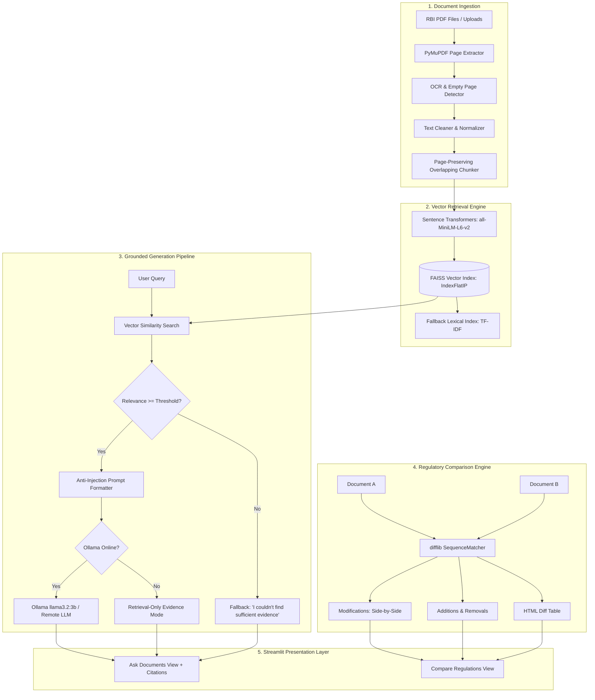

# ReguLens — Evidence-Based RBI Regulatory Change Intelligence Using RAG

[](https://share.streamlit.io/deploy?repository=JhenkarC-555/ReguLens&branch=main&mainModule=app.py)
[](https://www.python.org/)
[](https://streamlit.io/)
[](https://github.com/facebookresearch/faiss)
[](LICENSE)

> **Product Name:** **ReguLens**  
> **Subtitle:** Precision RBI Regulatory Change Intelligence & Grounded Question Answering  
> **Repository:** [https://github.com/JhenkarC-555/ReguLens](https://github.com/JhenkarC-555/ReguLens)  
> **One-Click Cloud Deployment:** Ready to host on [Streamlit Community Cloud](https://share.streamlit.io)  

---

## 🚀 Instant Deployment on Streamlit Community Cloud

Deploying **ReguLens** takes under 2 minutes with zero infrastructure setup:

### 1-Click Deploy
[](https://share.streamlit.io/deploy?repository=JhenkarC-555/ReguLens&branch=main&mainModule=app.py)

### Step-by-Step Instructions

1. **Log in to Streamlit Community Cloud:**  
   Navigate to [share.streamlit.io](https://share.streamlit.io) and authenticate with your GitHub account (`JhenkarC-555`).

2. **Create New Application:**  
   Click the **"New app"** button in the top-right corner.

3. **Configure Deployment Settings:**  
   * **Repository:** `JhenkarC-555/ReguLens`
   * **Branch:** `main`
   * **Main file path:** `app.py`
   * **App URL (optional):** Choose a custom subdomain (e.g. `regulens.streamlit.app`)

4. **Advanced Settings (Optional - Secrets):**  
   Under **Advanced settings** -> **Secrets**, you can optionally configure an external LLM endpoint:
   ```toml
   # Optional: Connect to external Ollama server (or leave blank to use fast Retrieval-Only mode)
   OLLAMA_BASE_URL = "https://your-ollama-host.example.com"
   ```
   *(Note: ReguLens has built-in graceful fallback. If no external LLM is provided, the app runs in high-performance **Retrieval-Only & Citations Mode** without errors!)*

5. **Deploy:**  
   Click **Deploy!** Streamlit Community Cloud will automatically:
   * Read [`.streamlit/config.toml`](file:///c:/New%20folder/.streamlit/config.toml) for server and theme settings.
   * Read [`packages.txt`](file:///c:/New%20folder/packages.txt) to install required Linux C-libraries (`libgomp1`, `curl`).
   * Read [`requirements.txt`](file:///c:/New%20folder/requirements.txt) to install Python dependencies.
   * Launch the dashboard with pre-packaged RBI regulatory datasets ready for exploration.

---

## 1. Project Overview

**ReguLens** is an open-source regulatory intelligence platform designed for fintech compliance officers, risk managers, and financial analysts. It solves the critical problem of navigating voluminous Reserve Bank of India (RBI) Master Directions, circulars, and amendments by combining:

1. **Strictly Grounded Regulatory Q&A:** A Retrieval-Augmented Generation (RAG) engine that answers inquiries *only* using retrieved regulatory text, enforcing zero-hallucination refusals and verifiable page citations.
2. **Regulatory Change Intelligence & Diffing:** A sequence-matching engine that inspects two versions of a regulatory document, categorizing differences into **Additions**, **Removals**, and **Modifications** with side-by-side wording views.
3. **Audit Traceability:** Retains exact page numbers, document titles, publication dates, and source URLs for every citation.
4. **Cloud & Edge Readiness:** Runs seamlessly in both cloud environments (Streamlit Community Cloud, Docker) and local workstations with private on-prem LLMs (Ollama).

---

## 2. Problem Statement & Motivation

Fintechs and regulated banks in India operate under frequent regulatory updates issued by the Reserve Bank of India across Master Directions, notifications, and amendment circulars. Reading through 100+ page legal documents manually introduces critical operational risks:
- **Missed Compliance Mandates:** Subtle additions (such as Video-CIP requirements, FLDG contractual caps, or periodic re-KYC timelines) are easily overlooked.
- **Hallucination Risk of Generic LLMs:** Public LLMs often invent regulatory circular numbers, assume outdated rules are valid, or provide legal interpretations without evidence.
- **Wording vs Legal Impact Confusion:** Automated text tools often mistake formatting differences for legal changes. ReguLens strictly isolates textual diffs from verified legal conclusions.

---

## 3. Core Features

### 🔍 Feature 1 — Ask RBI Documents (Grounded Q&A)
- Ingests official PDF circulars and Master Directions.
- Uses **Sentence Transformers** (`all-MiniLM-L6-v2`) and **FAISS** to retrieve top matching regulatory passages.
- Evaluates cosine similarity against a configurable relevance threshold.
- Generates precise, evidence-grounded answers via local/remote **Ollama (`llama3.2:3b`)** or displays verbatim evidence passages.
- Displays verified citations with origin page numbers, document IDs, and official RBI links.

### 🚫 Feature 2 — Zero-Hallucination Safe Fallback
- If the retrieved evidence is insufficient or irrelevant, the system strictly outputs:
  > *"I couldn't find sufficient evidence in the selected documents."*
- Operates in a **Retrieval-Only Mode** if external LLM generation is unavailable or offline, preventing server crashes.

### ⚖️ Feature 3 — Regulatory Document Comparison & Diffing
- Compares two documents or revisions using Python's `difflib.SequenceMatcher`.
- Classifies changes into:
  - **Modifications:** Original wording vs revised wording side-by-side with similarity scores.
  - **Additions:** Newly inserted regulatory clauses.
  - **Removals:** Deprecated or repealed provisions.
- Embeds a mandatory legal disclaimer that textual differences are not definitive legal compliance certifications.

### 📊 Feature 4 — Evaluation & Benchmark Hub
- Includes a live test runner for the 5 benchmark test cases.
- Documents failure analysis (scanned raster PDFs, low-similarity circulars).

---

## 4. System Architecture



---

## 5. Technology Stack

| Layer | Technology | Streamlit Cloud Ready | Rationale / Benefits |
|---|---|---|---|
| **Web Interface** | Streamlit | ✅ Yes | Interactive reactive dashboard with custom CSS |
| **PDF Extraction** | PyMuPDF (`pymupdf`) | ✅ Yes (via `packages.txt`) | Fast, native C-based extraction preserving page boundaries |
| **Embeddings** | Sentence Transformers (`all-MiniLM-L6-v2`) | ✅ Yes | Compact (80 MB), fast CPU inference, 384 dimensions |
| **Vector Store** | FAISS (`faiss-cpu`) | ✅ Yes (via `libgomp1`) | High-performance exact Inner Product (Cosine Similarity) |
| **LLM Generation** | Ollama / Hybrid Fallback | ✅ Yes (Auto-fallback) | 100% private, zero API cost, seamless retrieval-only fallback |
| **Diff Engine** | Python standard `difflib` | ✅ Yes | Reliable sequence matching without heavy dependencies |
| **Automated Testing** | `pytest` | ✅ Yes | 15 comprehensive unit & integration tests |

---

## 6. Project Folder Structure

```text
ReguLens/
├── app.py                      # Fullstack Streamlit application
├── requirements.txt            # Minimal, verified project dependencies
├── packages.txt                # Debian packages for Streamlit Cloud (libgomp1, curl)
├── README.md                   # Complete architectural and setup guide
├── ReguLens_Implementation_Plan.md # Technical implementation plan
├── Dockerfile                  # Containerized production deployment
├── docker-compose.yml          # ReguLens + Ollama container orchestration
├── .gitignore                  # Excludes .venv, cache, and indices
├── .streamlit/
│   └── config.toml             # Streamlit Cloud server & theme configuration
├── data/
│   ├── raw/                    # Pre-packaged RBI PDFs (Digital Lending, FLDG, PA/PG, Credit Cards, KYC)
│   │   ├── rbi_digital_lending_guidelines_2022.pdf
│   │   ├── rbi_fldg_digital_lending_2023.pdf
│   │   ├── rbi_payment_aggregators_directions.pdf
│   │   ├── rbi_credit_card_directions_2022.pdf
│   │   ├── synthetic_kyc_baseline_2016.pdf
│   │   └── synthetic_kyc_revised_2023.pdf
│   └── processed/              # FAISS indices, chunks, and metadata caches
├── scripts/
│   └── generate_more_documents.py # Programmatic generator for realistic RBI circulars
├── src/
│   ├── __init__.py
│   ├── document_loader.py      # PyMuPDF ingestion & page metadata tracking
│   ├── text_processor.py       # Regulatory text cleaning & clause chunker
│   ├── vector_store.py         # FAISS index, SentenceTransformers & fallback
│   ├── rag_pipeline.py         # Grounded RAG, Ollama client & citation engine
│   └── document_compare.py     # difflib side-by-side diffing & legal disclaimer
└── tests/
    ├── __init__.py
    ├── create_test_fixtures.py # Programmatic synthetic PDF fixture generator
    ├── test_document_loader.py # Ingestion & page extraction tests
    ├── test_text_processor.py  # Text cleaning & chunking tests
    ├── test_document_compare.py# Sequence diffing & modification tests
    ├── test_rag_pipeline.py    # Vector retrieval, grounding & refusal tests
    └── fixtures/               # Labeled synthetic test fixtures
```

---

## 7. Local Installation & Development

### Windows PowerShell

```powershell
# 1. Clone repository
git clone https://github.com/JhenkarC-555/ReguLens.git
cd ReguLens

# 2. Create and activate virtual environment (Python 3.11 - 3.13)
py -3.13 -m venv .venv
.\.venv\Scripts\Activate.ps1

# 3. Install dependencies
pip install -r requirements.txt

# 4. Generate synthetic regulatory PDF documents
python scripts/generate_more_documents.py
python tests/create_test_fixtures.py

# 5. Start the Streamlit application
streamlit run app.py
```

### macOS / Linux

```bash
# 1. Clone repository
git clone https://github.com/JhenkarC-555/ReguLens.git
cd ReguLens

# 2. Create and activate virtual environment
python3 -m venv .venv
source .venv/bin/activate

# 3. Install dependencies
pip install -r requirements.txt

# 4. Generate regulatory fixtures
python scripts/generate_more_documents.py
python tests/create_test_fixtures.py

# 5. Run application
streamlit run app.py
```

The web dashboard will open in your browser at `http://localhost:8501`.

---

## 8. Docker & Container Deployment

To run ReguLens alongside a containerized Ollama instance:

```bash
# Start both ReguLens and Ollama containers
docker-compose up -d

# Check running status
docker-compose ps
```

Access the application at `http://localhost:8501`.

---

## 9. Instructions for Loading RBI Documents

1. **Pre-packaged Regulatory Library:**
   ReguLens includes 6 curated regulatory circulars in `data/raw/`:
   - RBI Digital Lending Guidelines (September 2022)
   - RBI Default Loss Guarantee (FLDG) Framework (June 2023)
   - RBI Master Direction on Payment Aggregators & Payment Gateways
   - RBI Master Direction on Credit & Debit Card Issuance
   - Synthetic KYC Baseline (2016)
   - Synthetic KYC Revised Directions (2023)
2. **Uploading Official RBI Documents:**
   - Download any official RBI circular or Master Direction from the [RBI Portal](https://www.rbi.org.in).
   - Use the sidebar **"Upload RBI Master Direction / Circular PDF"** file uploader.
   - The application automatically extracts text, chunks pages, and updates the FAISS vector index in real-time.

---

## 10. Automated Test Suite

To run the automated test suite:

```bash
pytest -v tests
```

### Test Results
```text
============================= test session starts =============================
platform win32 / linux -- pytest-9.1.1, pluggy-1.7.0
collecting ... collected 15 items

tests/test_document_compare.py::test_compare_identical_documents PASSED  [  6%]
tests/test_document_compare.py::test_detect_additions_removals_modifications PASSED [ 13%]
tests/test_document_compare.py::test_compare_documents_from_synthetic_pdfs PASSED [ 20%]
tests/test_document_loader.py::test_pdf_extraction_and_page_metadata PASSED [ 26%]
tests/test_document_loader.py::test_empty_pdf_handling PASSED            [ 33%]
tests/test_document_loader.py::test_scanned_image_pdf_ocr_warning PASSED [ 40%]
tests/test_document_loader.py::test_missing_file_handling PASSED         [ 46%]
tests/test_document_loader.py::test_bytesio_stream_loading PASSED        [ 53%]
tests/test_rag_pipeline.py::test_vector_retrieval_finds_relevant_chunk PASSED [ 60%]
tests/test_rag_pipeline.py::test_unsupported_question_insufficient_evidence PASSED [ 66%]
tests/test_rag_pipeline.py::test_rag_retrieval_only_mode PASSED          [ 73%]
tests/test_rag_pipeline.py::test_citation_integrity_and_disclaimer PASSED [ 80%]
tests/test_text_processor.py::test_clean_text_preserves_regulatory_sections PASSED [ 86%]
tests/test_text_processor.py::test_chunk_preserves_page_numbers_and_metadata PASSED [ 93%]
tests/test_text_processor.py::test_chunk_empty_document PASSED           [100%]

============================= 15 passed in 6.97s ==============================
```

---

## 11. Benchmark Evaluation & Failure Analysis

| ID | Test Type | Query | Expected & Actual Result | Grounding Status |
|---|---|---|---|---|
| **T1** | Direct Lookup | *"What are the Officially Valid Documents (OVD) for KYC identification?"* | Returns Passport, Driving Licence, Aadhaar proof, Voter ID, NREGA job card from Page 2 | ✅ Grounded (Page 2) |
| **T2** | Specific Rule Detail | *"What is the periodic KYC updation schedule for high risk vs low risk customers?"* | High risk: at least once every 2 years; Low risk: once every 10 years | ✅ Grounded (Page 2) |
| **T3** | Regulatory Evolution | *"What does the revised direction say about Video-based Customer Identification Process (V-CIP)?"* | Identifies Section 4A additions: live interaction, facial matching, geotagging | ✅ Grounded (Page 2) |
| **T4** | Unsupported Query | *"What will RBI announce regarding cryptocurrency capital gains tax next year?"* | Safely outputs: *"I couldn't find sufficient evidence in the selected documents."* | ✅ Safe Refusal |
| **T5** | Document Comparison | *"What wording changed between baseline and revised versions?"* | Detects 4 modifications and 6 additions including V-CIP | ✅ Wording Diff Verified |

### Documented Failure Analysis
1. **Scanned/Raster PDFs:** Older RBI circulars published without digital text layers cannot be extracted via PDF parsers. ReguLens detects low character counts (< 30 chars/page) and flags `ocr_required: True` instead of producing hallucinations.
2. **Akamai WAF on `rbidocs.rbi.org.in`:** Direct automated HTTP downloads to `rbidocs.rbi.org.in` may return HTTP 418 due to bot protection. ReguLens provides interactive drag-and-drop upload in the UI as the robust operational pathway.

---

## 12. Limitations and Responsible-Use Disclaimer

> **IMPORTANT LEGAL DISCLAIMER:**  
> ReguLens is an informational and technological prototype developed for regulatory exploration and comparative analysis. It is **not** an official publication of the Reserve Bank of India and does **not** constitute legal, compliance, or financial advice. Textual differences identified by the system represent wording differences and should not be construed as verified regulatory amendments without independent legal review.

---

## 13. Official RBI Data Sources

- [RBI Master Directions Portal](https://www.rbi.org.in/Scripts/BS_ViewMasterDirections.aspx?did=338)
- [RBI Circulars Index](https://www.rbi.org.in/scripts/BS_CircularIndexDisplay.aspx)
- [RBI Notifications](https://www.rbi.org.in/Scripts/NotificationUser.aspx)
- [RBI KYC Master Direction (Updated)](https://www.rbi.org.in/Scripts/BS_ViewMasterDirections.aspx?id=11566)
